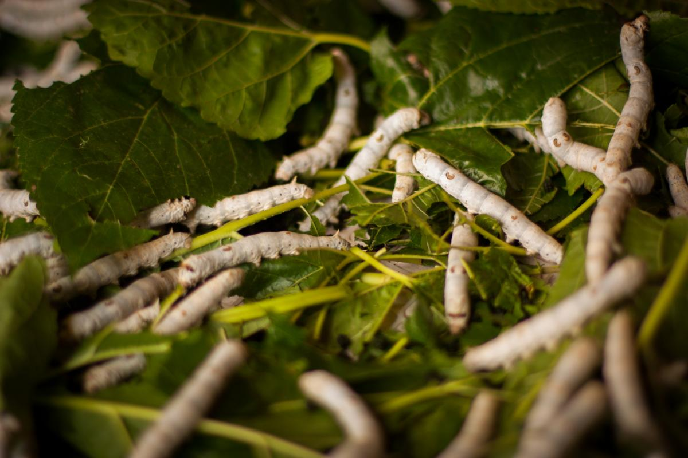
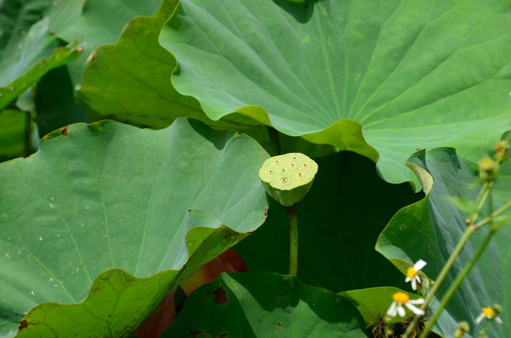
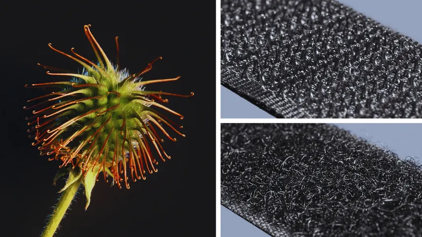

# Biomímesis: aprender observando la naturaleza.

**Autor:** Martin Mendez
**Email:** [martinmendez@unc.edu.ar](mailto:martinmendez@unc.edu.ar)
**Afiliación:** Facultad de Matemática, Astronomía, Física y Computación, Universidad Nacional de Córdoba and Instituto de Física Enrique Gaviola, CONICET-UNC, Ciudad Universitaria, Córdoba X5000HUA, Argentina

**(Fecha: 25 de Octubre de 2025)**

-----

## 1\. Introducción

### 1.1. Historia y definición

[cite\_start]El filósofo griego Aristóteles decía que para lograr sus fines, el arte imita a la naturaleza[cite: 1]. [cite\_start]Hoy, no sólo los artistas, sino grupos de ingenieros, físicos, médicos, biólogos y otros científicos están diseñando y construyendo artefactos capaces de replicar las formas y funciones naturales de los organismos[cite: 2]. [cite\_start]Los propósitos, más que estéticos, son prácticos: aprender cómo la naturaleza, a través de miles de millones de años de evolución, ha generado soluciones que permiten a los seres vivos adaptarse a su entorno y sobrevivir, para luego aplicar esas estrategias en beneficio del ser humano[cite: 3]. [cite\_start]El concepto de **biomimicry** (**biomimética** o **biomímesis**) tiene sus raíces en la observación de la naturaleza como fuente de soluciones eficientes y sostenibles a problemas complejos, inspirando innovaciones tecnológicas[cite: 4]. [cite\_start]Históricamente, el interés humano por imitar la naturaleza se remonta a tiempos antiguos, con ejemplos clásicos como el uso de la **seda** proveniente de gusanos de seda desde el 4000 a.C. [cite: 5] (ver Fig. 1) [cite\_start]y la invención del **paraguas** en China hace unos 1700 años, inspirado en las hojas de loto para protegerse de la lluvia (ver Fig. 2)[cite: 6].

\<figure\>
\
\<figcaption\>
**Fig. [cite\_start]1:** La seda es uno de los primeros ejemplos de biomímesis que se encuentran en la historia humana[cite: 7]. [cite\_start]El uso de este material se remonta al año 4000 a.C., convirtiéndolo en una de las primeras telas inventadas por el ser humano[cite: 8]. [cite\_start]Es bien sabido que la seda proviene de los gusanos de seda, y los chinos fueron la primera civilización en aprender de este increíble gusano[cite: 9]. [cite\_start]Esta invención fue la razón por la cual la Ruta de la Seda recibió su nombre[cite: 10]. [cite\_start]Durante la época en la que solo los chinos habían dominado la técnica del tejido, la seda podía ser intercambiada por su peso equivalente en oro[cite: 11]. [cite\_start]Seis mil años después, todavía seguimos usando seda en todo el mundo[cite: 12].
\</figcaption\>
\</figure\>

\<figure\>
\
\<figcaption\>
**Fig. [cite\_start]2:** Los primeros paraguas chinos fueron inventados hace 1700 años por un hombre llamado Lu Ban, quien ahora es venerado en la historia china[cite: 12]. [cite\_start]La idea del paraguas surgió cuando Lu Ban vio a niños usando hojas de loto para protegerse de la lluvia[cite: 13]. [cite\_start]Decidió imitar la flexibilidad y efectividad de la hoja para crear un producto propio[cite: 14]. [cite\_start]Los primeros paraguas fueron, de hecho, hechos de seda[cite: 14].
\</figcaption\>
\</figure\>

[cite\_start]El término **biomímesis** (del griego *bios*, vida y *mímesis*, imitación) fue utilizado formalmente por primera vez en 1957 por el Otto Schmidt en el contexto de transferir teorías biológicas a soluciones tecnológicas y luego popularizado por **Janine Benyus**, quien en 1997 definió la biomimética como una ciencia nueva que estudia los modelos de la naturaleza para inspirar soluciones a problemas humanos[cite: 15].

Existe una definición de biomímesis propuesta por Hwang y colaboradores:

> [cite\_start]La biomimética es el estudio de la naturaleza y los fenómenos naturales para comprender los principios de los mecanismos subyacentes, obtener ideas de la naturaleza y aplicar conceptos que puedan beneficiar a la ciencia, la ingeniería y la medicina[cite: 16].

### 1.2. Concepto

Para entender el concepto detrás de la biomímesis es útil recordar las nueve leyes, estrategias o principios en que se basa la naturaleza según Janine Benyus:

> [cite\_start]La naturaleza... [cite: 17]
> [cite\_start]1.  ... funciona con la luz del sol[cite: 18].
> [cite\_start]2.  ... sólo usa la energía que necesita[cite: 18].
> [cite\_start]3.  ... adapta la forma a la función[cite: 19].
> [cite\_start]4.  ... lo recicla todo[cite: 19].
> [cite\_start]5.  ... recompensa la cooperación[cite: 19].
> [cite\_start]6.  ... se apoya en la diversidad[cite: 20].
> [cite\_start]7.  ... exige conocimientos técnicos locales[cite: 20].
> [cite\_start]8.  ... frena los excesos desde el interior[cite: 21].
> [cite\_start]9.  ... optimiza[cite: 21].

Antonio Gaudí (1852-1926) decía que:

> [cite\_start]El arquitecto del futuro se basará en la imitación de la naturaleza, porque es la forma más racional, duradera y económica de todos los métodos[cite: 22].

[cite\_start]La arquitectura biomimética busca soluciones sostenibles en la naturaleza, no a través de la réplica de sus formas, sino a través de la comprensión de las normas y principios que las rigen[cite: 23]. [cite\_start]Se trataría por tanto, de imitar no solo la forma, sino también el funcionamiento[cite: 24].

Gaudí expresaba la importancia de la biomimética:

> [cite\_start]Originalidad quiere decir volver al origen y el origen es la naturaleza y las leyes que la rigen[cite: 25].

Janine Benyus afirma que:

> [cite\_start]El primer nivel es imitar la forma natural[cite: 26]. [cite\_start]Pero se puede acceder a un segundo nivel, que es cuando se imita el proceso natural[cite: 27].

### 1.3. La biomímesis como filosofía de vida

[cite\_start]La biomímesis estudia en profundidad el comportamiento de la naturaleza en todos sus estadios, escalas de relación y desarrollo en el ámbito de la biosfera y busca entender su lenguaje para mejorar nuestro conocimiento[cite: 28]. [cite\_start]El objetivo es crear una cultura que nos permita establecer nuevos procesos más ecológicos y sostenibles, así como productos y estrategias para establecer formas de progreso que estén en equilibrio con la integridad del planeta[cite: 29]. [cite\_start]La biomímesis es una ciencia basada en la observación de nuestro planeta y de su larga evolución durante sus 3.800 millones de años de historia[cite: 30]. [cite\_start]Las moléculas orgánicas de los organismos biológicos de microbios, animales, plantas y hongos y de sus asociaciones han establecido estrategias de supervivencia capaces de subsistir gracias a la optimización del uso de recursos, de su organización y funcionamiento y, de adaptar su forma a su función[cite: 31].

Janine Benyus decía que:

> La naturaleza ya ha resuelto todos los retos a los que hoy nos enfrentamos y, sus fracasos se han convertido en fósiles, y lo que nos rodea es la clave de la supervivencia.

[cite\_start]Existen **tres elementos esenciales** en la ciencia de la biomímesis que son **emular**, **ethos** y **(re)conectar** y representan los valores fundamentales en los que se basa la biomímesis y que pretende transmitir en todas sus acciones y prácticas[cite: 32].

  * [cite\_start]**Emular**: La experiencia científica basada en la investigación de aprender y luego replicar las formas, procesos y ecosistemas de la naturaleza para crear diseños más regenerativos[cite: 33].
  * [cite\_start]**Ethos**: La filosofía de comprender cómo funciona la naturaleza y crear diseños que apoyen y creen continuamente resultados propicios para la vida[cite: 34].
  * [cite\_start]**(Re) Conectar**: El concepto de que todos somos parte de la naturaleza y encontramos valor en el reconocimiento de los sistemas interconectados de la vida[cite: 35]. (Re)[cite\_start]Conectar como práctica nos anima a observar y pasar tiempo en la naturaleza, a comprender cómo estamos profundamente conectados con ella, a experimentar nuestra interdependencia y a apreciar cómo funciona la vida y sus estrategias biológicas[cite: 36].

\<figure\>
\
\<figcaption\>
**Fig. [cite\_start]3:** La evolución anatómica de los pulpos (molusco cefalópodo) con su cuerpo musculoso y flexible de 8 brazos tentaculados, cerebro prodigioso y un sistema ocular de los más evolucionados del reino animal, es un milagro de la naturaleza y de la adaptación al medio marino[cite: 49]. [cite\_start]La biomimética estudia la forma y funcionamiento de sus ventosas para aplicaciones médicas e industriales, así como el sistema de visión para la aplicación en tecnología marina e invidentes[cite: 50]. Foto: Miquel Ventura Monsó --- Proyecto Silmar --- Fundación RAED.
\</figcaption\>
\</figure\>

\<figure\>
\
\<figcaption\>
**Fig. [cite\_start]4:** El gusano poliqueto de la especie *Spirográphis spallanzani* ha evolucionado hasta adquirir un diseño corporal y fisiológico que le permite, gracias a la modificación de sus apéndices, desarrollar un abanico en forma de plumero para captar el oxígeno del agua y a su vez alimentarse de las partículas en suspensión que transporta el agua marina[cite: 51]. Foto: Miquel Ventura Monsó – proyecto Silmar – Fundación RAED.
\</figcaption\>
\</figure\>

-----

## 2\. Personas relevantes

[cite\_start]Uno de los pioneros en el pensamiento biomimético fue **Leonardo da Vinci** (1452-1519), quien estudió y replicó mecanismos naturales como el vuelo de las aves para diseñar máquinas voladoras, sentando bases para la biónica (ver Fig. 5)[cite: 52].

\<figure\>
\
\<figcaption\>
**Fig. 5:** Leonardo da Vinci's design for a flying machine with wings based closely upon the structure of bat wings.
\</figcaption\>
\</figure\>

[cite\_start]El arquitecto catalán **Antonio Gaudí** (1852-1926), pionero en la aplicación intuitiva de principios biomiméticos, concibió la estructura de la Sagrada Familia en Barcelona como un gran bosque pétreo[cite: 53]. [cite\_start]Lejos de ser meros elementos decorativos, las columnas que se ramifican como troncos de árboles, las bóvedas que recuerdan hojas, y las espirales inspiradas en caracoles fueron diseñadas con una profunda intención estructural y funcional[cite: 54]. [cite\_start]Esta aproximación orgánica permite una distribución óptima de las cargas gravitatorias hacia el suelo, imitando la eficiencia de los sistemas naturales[cite: 55]. [cite\_start]Asimismo, estas formas, probadas durante más de un siglo contra la tramontana y las inclemencias del clima mediterráneo, confieren al edificio una excepcional resistencia y estabilidad frente a las fuerzas del viento[cite: 56]. [cite\_start]La obra de Gaudí es, por tanto, un testimonio temprano y monumental de cómo la mimesis de las formas y estrategias de la naturaleza puede generar estructuras no solo estéticamente sorprendentes, sino también extraordinariamente eficientes y resilientes (ver Fig. 6)[cite: 57].

\<figure\>
\
\<figcaption\>
**Fig. 6:** La Sagrada Familia aún en construcción.
\</figcaption\>
\</figure\>

[cite\_start]El biofísico **Otto H. Schmitt** (1913-1998) acuñó el término "**biomimética**" en la década de 1950 para describir la transferencia de ideas de la biología a la tecnología[cite: 58]. [cite\_start]Su trabajo se centró en transferir fenómenos biológicos, como la transmisión de señales en nervios, a aplicaciones de ingeniería electrónica, como el disparador de Schmitt[cite: 59].

[cite\_start]**George de Mestral** (1907-1990), aunque fue un inventor, su descubrimiento más famoso es el caso de éxito de biomímesis por excelencia: el **Velcro** (ver Fig. 7)[cite: 60]. [cite\_start]Inspirado por los ganchos de los frutos del cardo alpino (*Arctium*), democratizó el concepto de que la naturaleza ofrece soluciones elegantes a problemas simples[cite: 61].

\<figure\>
\
\<figcaption\>
**Fig. [cite\_start]7:** Mientras cazaba en los Alpes suizos con su perro, George de Mestral notó que los cadillos (o \`\`abrojos'') del bosque se pegaban a su ropa y al pelaje de su perro[cite: 62]. [cite\_start]Aunque era un inconveniente, él lo vio como una oportunidad[cite: 63]. [cite\_start]Tras examinar los cadillos más de cerca, observó que su superficie estaba compuesta por muchos ganchos diminutos[cite: 64]. [cite\_start]Estos se adhieren a las cosas enredando estos ganchos en la estructura suelta de superficies como la tela o la piel animal[cite: 65]. [cite\_start]Inventó el Velcro imitando esta superficie cubierta de pequeños ganchos y combinándola con una superficie cubierta de pequeños bucles, dando como resultado el producto útil que conocemos hoy en día[cite: 66].
\</figcaption\>
\</figure\>

[cite\_start]**Claus Mattheck** (1947-presente) es un gigante en el campo de la biónica estructural[cite: 67]. [cite\_start]Desarrolló el "método de optimización de la tensión superficial" y demostró cómo los árboles optimizan su forma para soportar cargas, principios que luego aplicó para diseñar componentes más ligeros y resistentes en la industria automotriz y aeroespacial[cite: 68].

[cite\_start]**Janine Benyus** (1958) es conocida como la fundadora del movimiento de biomímesis[cite: 69]. [cite\_start]Ella recogió todas sus teorías en un libro llamado "Biomimesis: innovaciones inspiradas por la naturaleza" (ver Fig. 8)[cite: 70]. [cite\_start]En 1998, Janine Benyus y Dayna Baumeister fundaron la biomímesis, que utiliza un profundo conocimiento de la adaptación biológica de los organismos para ayudar a los diseñadores, ingenieros y arquitectos a resolver problemas de diseño e ingeniería de manera sostenible[cite: 71]. [cite\_start]En 2008, se desarrolla el “portal de biomímesis”, que es la primera base de datos digital para organismos biológicos que tienen estrategias para resolver problemas acordes con la comunidad humanitaria[cite: 72]. [cite\_start]En 2005, Bryony Schan y Janine Benyus cofundaron el [Instituto de Biomímesis](https://biomimicry.org/), en 2007 Chris Allen se unió a Beynus y Schwan para lanzar ["AskNature"](https://asknature.org/), primera biblioteca digital del mundo que contiene una lista de soluciones naturales donde los diseñadores pueden buscar a través de esta colección de sistemas naturales, clasificados según su diseño e ingeniería[cite: 73]. [cite\_start]Janine Benyus está considerada como una de las personas clave responsables de desarrollar el campo de la biomimética en un área más reconocida y distinguida hoy en día[cite: 74]. [cite\_start]Fundó su propia organización de consultoría líder en el mundo, Biomimética 3.8[cite: 75]. [cite\_start]Su misión es enseñar al mundo a innovar, aprender e inspirarse en la naturaleza[cite: 76]. [cite\_start]Ella continúa esforzándose por un futuro que escuche a la tierra en lugar de explotarla[cite: 77]. [cite\_start]Ella enmarca el concepto de biomimética en torno al urgente objetivo de acabar con la destrucción del medio ambiente[cite: 78]. [cite\_start]Dijo en el National Geographic, "Ojalá hubiéramos estado en la mesa de diseño de la Revolución Industrial"[cite: 79].

\<figure\>
\
\<figcaption\>
**Fig. 8:** Portada del libro escrito por Janine Benyus “Biomímesis. Innovaciones inspiradas por la naturaleza”.
\</figcaption\>
\</figure\>

[cite\_start]En sus inicios, Baumeister y Benyus se plantearon la cuestión fundamental de cómo sentar las bases de una disciplina emergente: por dónde empezar y cómo construir las instituciones necesarias[cite: 80]. [cite\_start]Llegaron a la conclusión de que el objetivo último era canalizar la sabiduría de la naturaleza e integrarla en el ámbito del diseño de sistemas humanos, abarcando la ingeniería, la medicina, la política, el arte, entre otros[cite: 81]. [cite\_start]Para ello, era crucial crear un marco de trabajo que conectara de manera eficaz las soluciones desarrolladas por la naturaleza con los desafíos humanos[cite: 82]. [cite\_start]La genialidad de su propuesta fue simplificar este proceso en una pregunta esencial: "¿Cómo lo resolvería la naturaleza?" [cite: 83] (What would nature do?). Sin embargo, para que esta pregunta fuera útil, debía tener una respuesta accesible. [cite\_start]Así nació [AskNature](https://asknature.org/)[cite: 84]. [cite\_start]La paradoja que impulsó este proyecto es la siguiente: los profesionales que diseñan nuestro mundo (ingenieros, arquitectos, diseñadores) rara vez reciben formación en biología[cite: 85]. [cite\_start]Sin embargo, son ellos quienes crean las tecnologías y soluciones que moldean nuestra existencia[cite: 86]. [cite\_start]Por ejemplo, un ingeniero puede diseñar una bomba hidráulica compleja para un motor de combustión, sin conocer que la naturaleza ha perfeccionado un sistema de bombeo extraordinariamente eficiente en el corazón de una ballena, capaz de mover sangre a través de una vasta red de vasos[cite: 87]. [cite\_start]Los biólogos conocen estos sistemas, pero su conocimiento no suele llegar a los creadores[cite: 88]. [cite\_start]AskNature surge precisamente para tender un puente entre estos dos saberes, conectando la *expertise* biológica con la ingenieril en el momento mismo de la creación[cite: 88].

-----

## 3\. Ejemplos destacados

### 3.1. Matemática

#### Grafos

[cite\_start]En el 2012 se publicó un trabajo científico que se inspira en el comportamiento natural de los machos de la **rana arborícola japonesa** (*Hyla japonica*, ver Fig. 9), que emiten sus cantos para atraer a las hembras[cite: 89]. [cite\_start]Cuando varios machos están cerca y cantan simultáneamente, las hembras no pueden distinguir de dónde provienen las llamadas, lo que dificulta la elección del compañero[cite: 90]. [cite\_start]Para solucionar esto, los machos **desincronizan sus cantos**, es decir, ajustan los intervalos temporales de sus llamados para que no se superpongan, facilitando que las hembras localicen individualmente a cada macho[cite: 91]. [cite\_start]Este fenómeno natural de desincronización se ha modelado matemáticamente mediante sistemas de osciladores acoplados, donde cada macho se representa como un nodo en un grafo, y las conexiones entre nodos reflejan la posibilidad de confusión entre cantos debido a la proximidad[cite: 92]. [cite\_start]El algoritmo desarrollado usa esta idea de desincronización para resolver el problema del **coloreado distribuido de grafos**, que consiste en asignar colores a nodos conectados de modo que nodos vecinos tengan colores diferentes[cite: 93]. [cite\_start]Cada fase de canto corresponde a un color, y al desincronizarse, los nodos logran minimizar el número de colores usados sin que se superpongan, equivalente a permitir conexiones inalámbricas sin interferencias o gestionar tareas en redes distribuidas sin coordinación central[cite: 94]. [cite\_start]Este algoritmo bioinspirado es distribuido, lo que significa que cada nodo usa solo información local para decidir su color, imitando cómo los machos ranas ajustan sus cantos sin un controlador central[cite: 95]. [cite\_start]El método ha mostrado resultados competitivos para diversos tipos de grafos, siendo útil en aplicaciones concretas como asignación de frecuencias en redes inalámbricas, planificación de horarios o análisis de redes sociales para detectar comunidades independientes[cite: 96]. [cite\_start]En resumen, el estudio aprovecha la autoorganización natural de la desincronización en los cantos de las ranas arborícolas japonesas para diseñar un algoritmo eficiente y distribuido que soluciona combinatoriamente problemas complejos de coloreado en grafos, con amplias aplicaciones tecnológicas y computacionales[cite: 97].

\<figure\>
\
\<figcaption\>
**Fig. [cite\_start]9:** Durante los rituales de cortejo, las ranas macho japonesas (*Dryophytes japonicus*) atraen la atención de las hembras croando rítmicamente[cite: 98]. [cite\_start]Los machos vecinos tienden a alternar sus croaking (con una diferencia de fase) para evitar "hablar unos sobre otros" e interferir acústicamente[cite: 98].
\</figcaption\>
\</figure\>

### 3.2. Física

#### Fotosíntesis

[cite\_start]El trabajo de Ruban, Johnson y Duffy (2011) nos ofrece un ejemplo paradigmático de eficiencia energética inspirada por la naturaleza[cite: 99]. [cite\_start]Su estudio detallado de la antena del **fotosistema II** en plantas revela un sistema de captura de luz con una **eficiencia cuántica casi perfecta (80-100%)**, un estándar asombroso que cualquier tecnología humana aspira alcanzar[cite: 100]. [cite\_start]Esta prodigiosa eficiencia no es casual, sino que emerge de un diseño molecular exquisito[cite: 101]. [cite\_start]Los pigmentos y proteínas se organizan formando lo que los autores describen como un "**solvente programado**", que logra empacar una alta densidad de pigmentos sin que estos se "apaguen" entre sí[cite: 102]. [cite\_start]Esto se consigue gracias a orientaciones y acoplamientos precisos que prolongan la vida del estado excitado[cite: 103]. El sistema es, además, dinámicamente inteligente. [cite\_start]Pigmentos accesorios, las xantofilas, actúan como reguladores en tiempo real, modulando la eficiencia energética para proteger el sistema y adaptarse a las condiciones de luz[cite: 104]. [cite\_start]Incluso exhibe una suerte de "**memoria lumínica**", con un comportamiento histérico similar al de materiales ferroeléctricos, lo que le permite "recordar" exposiciones previas[cite: 105]. [cite\_start]Como modelo biomimético, este sistema biológico es una lección magistral de integración de fenómenos cuánticos, bioquímicos y físicos para lograr una función robusta y autoregulada[cite: 106]. [cite\_start]Sus principios—optimización del diseño, regulación adaptativa y explotación de efectos cuánticos—ofrecen un *blueprint* revolucionario para el diseño de nuevos materiales fotónicos, **células solares orgánicas** y sistemas de gestión de energía artificiales mucho más eficientes[cite: 107].

### 3.3. Ingeniería

#### Adhesivo

[cite\_start]Los científicos de la Universidad de Manchester han desarrollado un nuevo tipo de adhesivo que imita el mecanismo empleado por el lagarto **gecko** (ver Fig. 10) para adherirse a superficies e incluso caminar por techos de cristal[cite: 108]. [cite\_start]Este innovador material, a menudo llamado **cinta de gecko**, está compuesto por miles de millones de pequeñas fibras de plástico de menos de una micra de diámetro[cite: 109]. [cite\_start]Estas fibras sintéticas son análogas a los pelos microscópicos (*setae*) que recubren las plantas de los pies del gecko, los cuales generan **fuerzas de adhesión electrodinámicas (fuerzas de van der Waals)** a nivel molecular[cite: 110]. [cite\_start]Sorprendentemente, un centímetro cuadrado de esta cinta es capaz de soportar un peso de hasta un kilogramo[cite: 111]. [cite\_start]Más allá de sus aplicaciones como adhesivo general, este material puede ser utilizado para manipular chips de computadora en entornos de vacío o para recolectar muestras de pequeñas fibras sin dañarlas[cite: 112]. [cite\_start]Otra de sus ventajas significativas es que la cinta es reutilizable y no requiere de los productos químicos tóxicos presentes en los adhesivos convencionales[cite: 113].

\<figure\>
\
\<figcaption\>
**Fig. [cite\_start]10:** Ingenieros y estudiantes de la Universidad de Massachusetts estudiaron las almohadillas de las patas de los geckos y descubrieron que la razón por la que estos reptiles pueden arrastrarse por superficies verticales e incluso invertidas se debe a que sus pies están cubiertos por cientos de *setae*, es decir, fibras microscópicas similares a pelos[cite: 114]. [cite\_start]Estas fibras permiten al gecko adherirse a una superficie, pero también despegarse de ella con facilidad[cite: 114]. [cite\_start]El resultado de esta investigación fue el desarrollo de una sustancia adhesiva que, como era de esperar, se utiliza para adherir objetos a paredes y superficies de manera más eficiente[cite: 115].
\</figcaption\>
\</figure\>

#### Ondas de choque

[cite\_start]Para resolver el problema de los cambios bruscos de resistencia del aire y el estruendo sónico que generaban los trenes **Shinkansen** al entrar en los túneles, el equipo de diseño se inspiró en la naturaleza[cite: 116]. [cite\_start]Encontraron la solución perfecta en el pico del **martín pescador** (*Alcedo atthis*), evolucionado para bucear desde el aire al agua, es decir, de un medio de baja densidad a uno de alta densidad, con una pérdida mínima de energía y sin salpicadura[cite: 117]. [cite\_start]Mediante modelado por computadora, los ingenieros confirmaron que la forma aerodinámica única del pico del ave era la más idónea para el morro del tren[cite: 118]. [cite\_start]El resultado fue extraordinario: no solo se eliminó casi por completo el ruido de la onda de choque en los túneles, sino que, además, el tren pudo circular un **10% más rápido** consumiendo un **15% menos de electricidad**[cite: 119]. [cite\_start]Este caso es un paradigma de cómo la biomímesis puede optimizar múltiples parámetros de rendimiento de manera simultánea e inteligente (ver Fig. 11)[cite: 120].

\<figure\>
\
\<figcaption\>
**Fig. [cite\_start]11:** The Kingfisher bill inspired the bullet train’s streamline nose[cite: 121]. Image Credit: Common Kingfisher”, Shahin Olakara, licensed under CC BY 2.0 “Two Shinkosen”, Yercombe, licensed under CC BY-NC 2.0.
\</figcaption\>
\</figure\>

#### Resistencia de materiales

[cite\_start]La **telaraña** (ver Fig. 12) es uno de los ejemplos más emblemáticos de biomímesis aplicada al desarrollo de materiales resistentes. La seda de araña es un material natural compuesto por cadenas de proteínas organizadas en polímeros altamente resistentes[cite: 121]. [cite\_start]Es hasta **diez veces más fuerte que los aceros** más resistentes conocidos y supera en propiedades a materiales sintéticos como el Kevlar, empleado en chalecos antibalas[cite: 121].

[cite\_start]Además de su resistencia, la seda de araña combina flexibilidad y tenacidad, lo que le permite absorber gran cantidad de energía sin romperse[cite: 122]. [cite\_start]Estas propiedades hacen que la seda sea atractiva para investigación en campos como la nanotecnología, medicina (suturas y reparación de tejidos) y desarrollo de materiales ultrarresistentes y ligeros[cite: 123]. [cite\_start]El principal desafío, que aún persiste, es la producción escalable de seda artificial que iguale las propiedades de la natural[cite: 124]. [cite\_start]Sin embargo, la telaraña sigue siendo el "**santo grial**" de la biomímesis de materiales, inspirando continuamente nuevas líneas de investigación en ciencia de polímeros e ingeniería[cite: 125].

\<figure\>
\
\<figcaption\>
**Fig. 12:** Los tejidos del futuro podrían estar confeccionados con un tejido aditivo elaborado a imagen y semejanza de la seda de araña.
\</figcaption\>
\</figure\>

-----

## 4\. Links útiles

### Concepto general

  * [Biomimética o biomímesis. [cite\_start]I Parte: Definición y conceptos.](https://documentacion-cultura-biblioteca.blogspot.com/2020/10/biomimetica-o-biomimesis-i-parte.html) [cite: 126]
  * [Biomimética o biomímesis. [cite\_start]II Parte: Historia de la biomimética.](https://documentacion-cultura-biblioteca.blogspot.com/2020/10/biomimetica-o-biomimesis-ii-parte.html) [cite: 127]
  * [Biomimetics Wikipedia](https://en.wikipedia.org/wiki/Biomimetics)
  * [Biomímesis y desarrollo sostenible, un concepto revolucionario para afrontar los retos vitales de nuestra civilización](https://raed.academy/biomimesis-y-desarrollo-sostenible-un-concepto-revolucionario-para-afrontar-los-retos-vitales-de-nuestra-civilizacion/)
  * [Biomimética: tecnología que imita a la naturaleza](https://ciencia.unam.mx/leer/891/biomimetica-tecnologia-que-imita-a-la-naturaleza)
  * [Janine M. Benyus: Biomimicry, innovación inspirada por la naturaleza](https://www.di-conexiones.com/biomemetica-biomimicry-innovacion-inspirada-por-la-naturaleza/)
  * [The Promise of Biomimicry: Innovation and Design Inspired by Nature. (YouTube)](https://www.youtube.com/watch?v=Muzfdq25Qbc)

### Aplicaciones

  * [Biomimicry: A History](https://ehistory.osu.edu/exhibitions/biomimicry-history)
  * [The Shinkansen bullet train from JR-West](https://asknature.org/innovation/high-speed-train-inspired-by-the-kingfisher/)
  * [Cantos de rana y planificación de horarios](https://naukas.com/2016/11/28/cantos-de-rana-y-planificacion-de-horarios/)
  * [cite\_start][Las ranas que ayudan a detectar problemas en Twitter o Facebook](https://yorokobu.es/algoritmo-ranas/) [cite: 128]
  * [Materiales con futuro: ¿impresión aditiva de seda de araña?](https://faircompanies.com/articles/materiales-con-futuro-impresion-aditiva-de-seda-de-arana/)