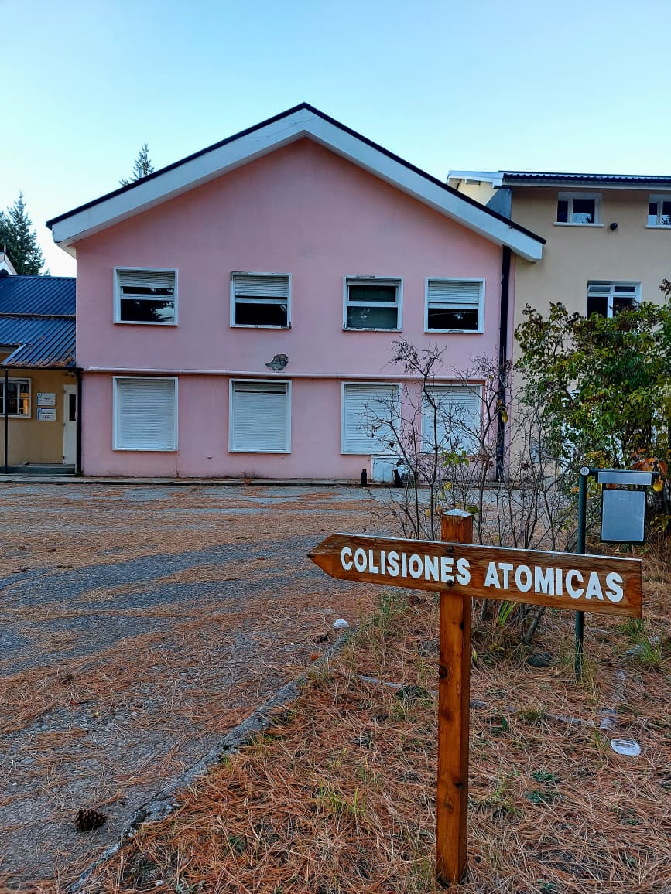
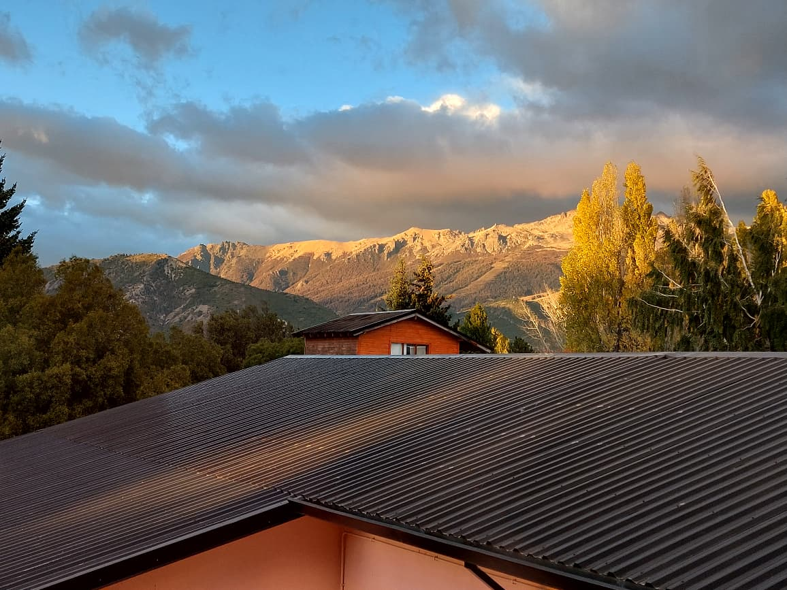
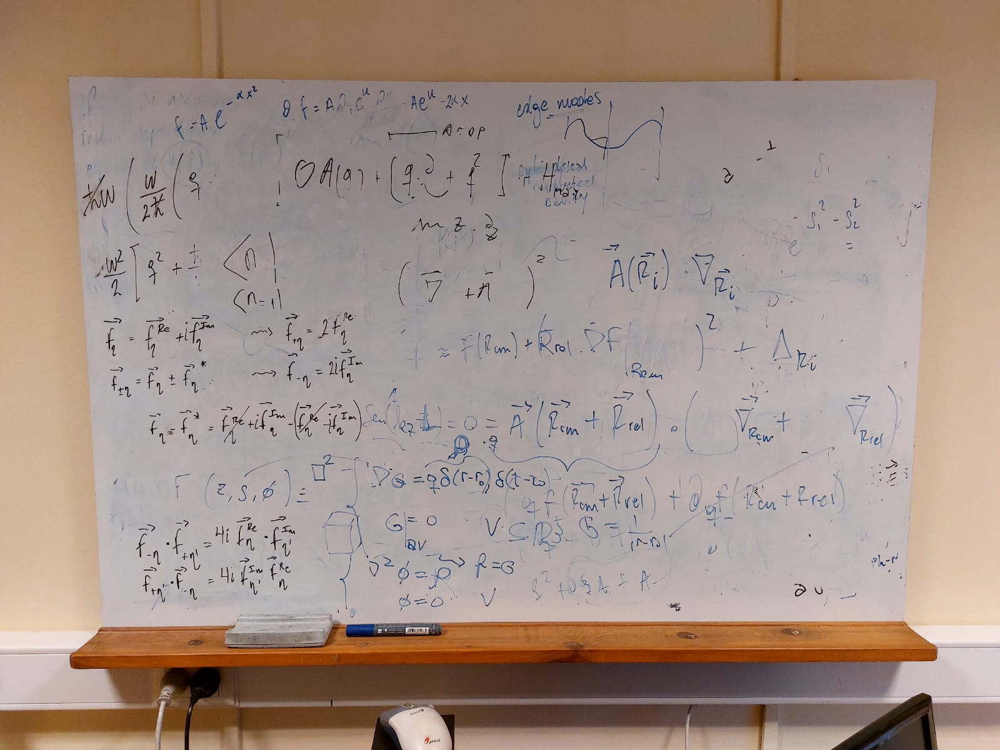
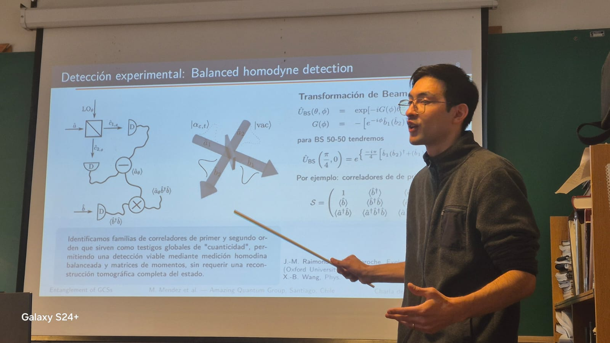
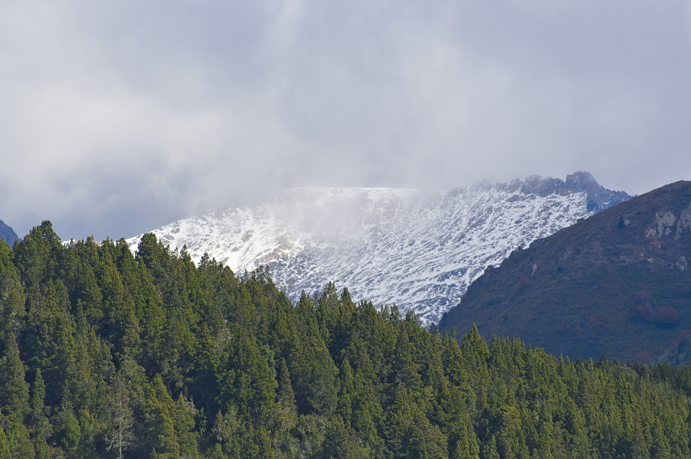
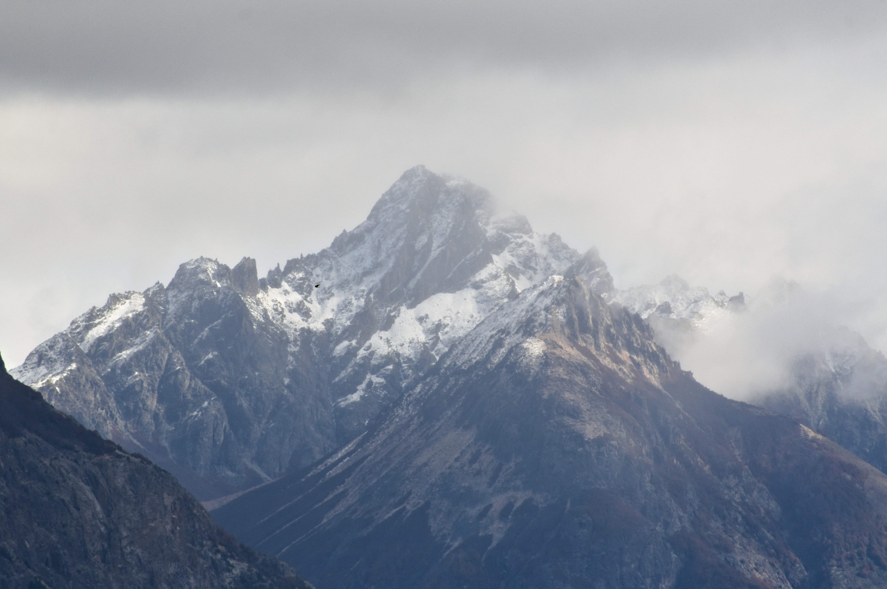
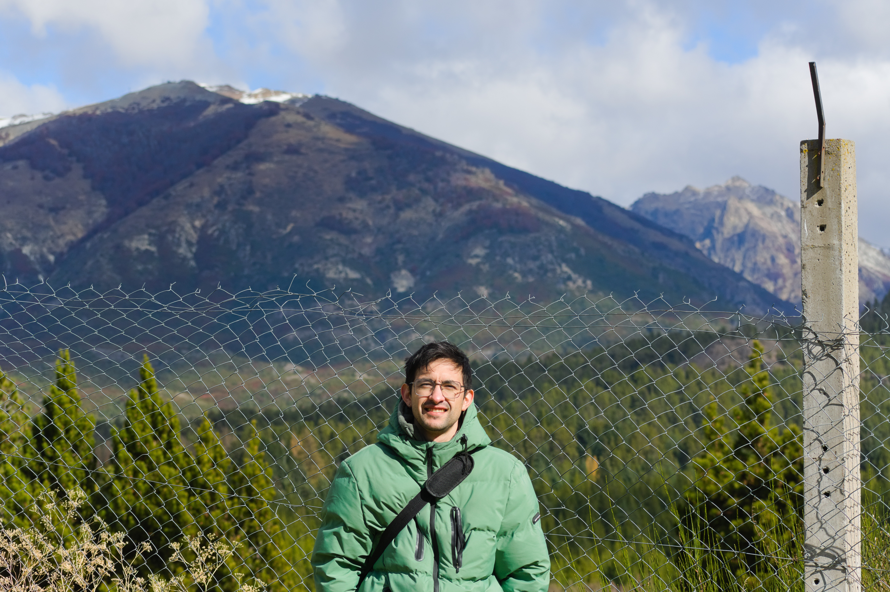

### Research stay in cavity QED: Collaboration between CAB and IFEG

In April 2026, I carried out a research stay at [the Atomic, Molecular and Optical Physics Group (FAMOP)](https://www.argentina.gob.ar/cnea/cab/laboratorio-de-colisiones-atomicas#1) of the Centro Atómico Bariloche (CAB), under the supervision of Drs. [Juan Martín Randazzo](https://scholar.google.com/citations?hl=en&user=esOP_I0AAAAJ) and [Renata Della Picca](https://scholar.google.com/citations?hl=en&user=QeylGgQAAAAJ). This stay is part of the ongoing collaboration between CAB and [the Instituto de Física Enrique Gaviola (IFEG)](https://bicyt.conicet.gov.ar/fichas/u/en/ifeg) at the Universidad Nacional de Córdoba (UNC), aimed at strengthening ties between both institutions and fostering joint research in polaritonic quantum chemistry. The stay was funded by the [Simons Foundation](https://www.simonsfoundation.org/) through the Simons-Balseiro Exchange program.

My work focused on extending a model we had been developing together with my thesis supervisor, [Dr. Federico Pont](https://scholar.google.com/citations?hl=en&user=7v2lR8IAAAAJ), to describe the interaction between a molecule confined in a cylindrical nanotube and a single mode of the electromagnetic field inside a Fabry-Perot QED cavity.

The starting point was to consider particle systems — electrons and nuclei — inside cylindrical cavities, where the cavity geometry determines the structure of the field modes. From there, we computed electrostatic potentials and spatially dependent electromagnetic modes using classical electromagnetism as the foundation. The next step was quantization: applying the fundamental principles of quantum electrodynamics, we constructed the field operators and coupled them to the matter operators to obtain the Pauli-Fierz Hamiltonian beyond the dipole approximation. This Hamiltonian allows us to describe how the cavity geometry affects the properties of confined quantum systems, with direct implications for the design of quantum devices based on cavity QED.

This stay yielded promising results, in particular concrete progress in the derivation of the Pauli-Fierz Hamiltonian for cylindrical geometry, which we hope will consolidate the CAB-IFEG collaboration and lead to joint publications.

Participating in the weekly meetings of the FAMOP group and presenting my progress was enormously enriching. The discussions with Juan Martín and Renata — who encouraged me to think creatively and explore different approaches to the mathematical problems that arose — were probably the most valuable aspect of the stay in terms of scientific training. I worked through a substantial amount of calculations, learned a great deal about classical and quantum electromagnetism, and tested myself in a demanding theoretical and mathematical environment. As a concrete outcome, I am leaving with a topic nearly fully developed for inclusion in my doctoral thesis, which I will be submitting in the near future.

The [Centro Atómico Bariloche](https://www.argentina.gob.ar/cnea/cab) and the [Instituto Balseiro](https://www.ib.edu.ar/) are internationally renowned institutions, with a tradition of researchers who have made fundamental contributions to physics. Having the privilege of living within the CAB grounds for a month and working daily alongside its researchers was an experience I made the most of and will not easily forget. I hope this collaboration continues to grow and deepen. It is a real opportunity to strengthen research in polaritonic quantum chemistry in Argentina and, on a personal level, it was one of the most formative experiences of my doctorate.

### Photo Gallery

::: {layout-ncol=3}
 planted on the grounds of the [Centro Atómico Bariloche](https://www.argentina.gob.ar/cnea/cab).](figures/2026_simons_balseiro_01.jpeg)

, [Balseiro](https://es.wikipedia.org/wiki/Jos%C3%A9_Antonio_Balseiro), [Beck](https://en.wikipedia.org/wiki/Guido_Beck), and others.](figures/2026_simons_balseiro_06.jpeg)

.](figures/2026_simons_balseiro_07.jpeg)

<!--  -->
:::

<!-- quarto render april_2026_simons_balseiro.qmd --to html
quarto render april_2026_simons_balseiro.qmd --to pdf -->