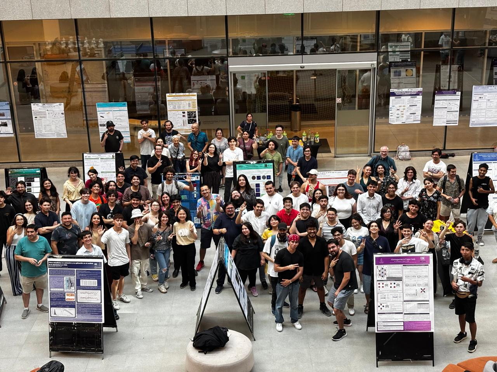
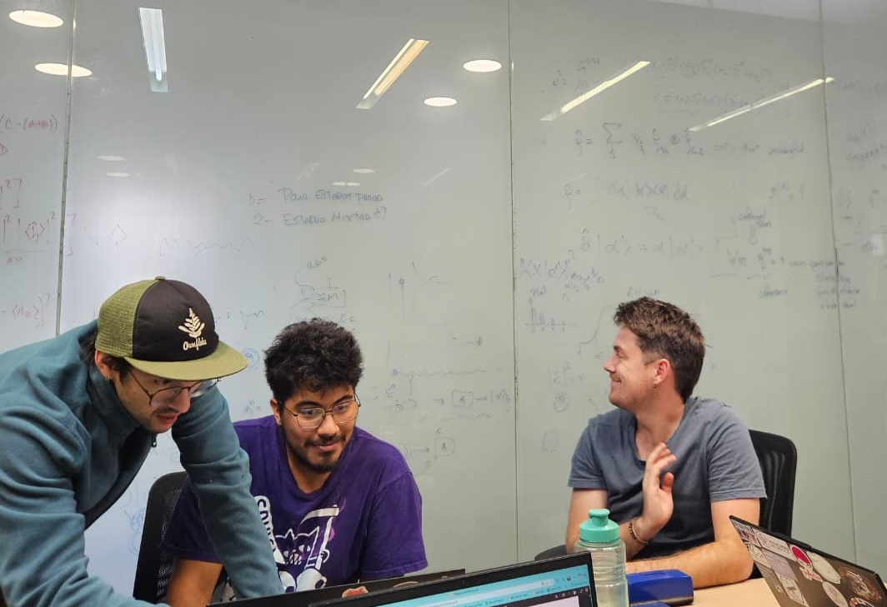
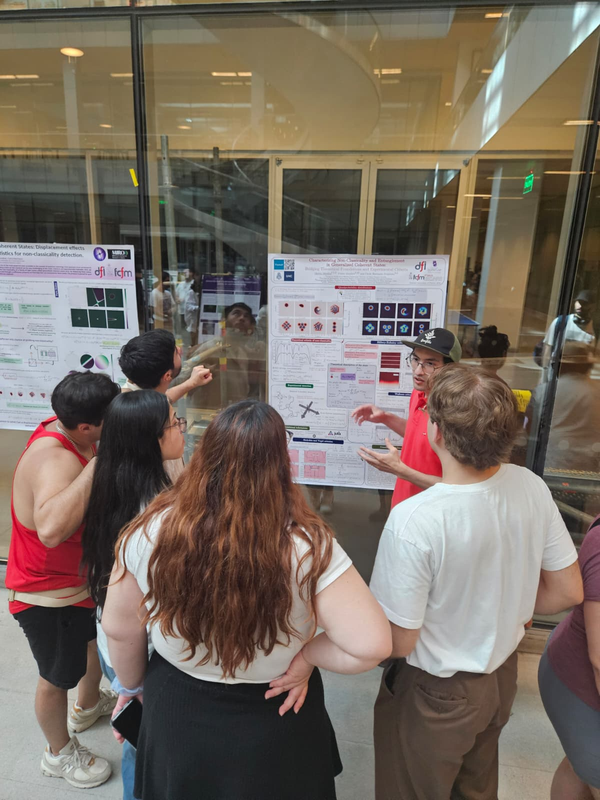
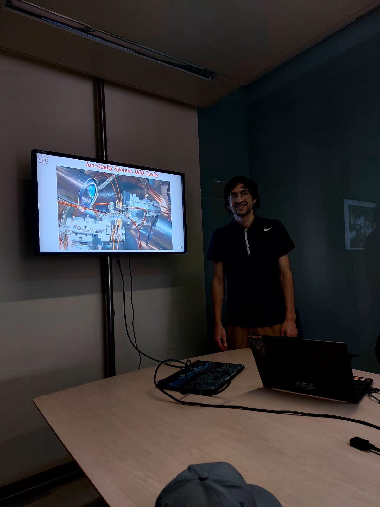
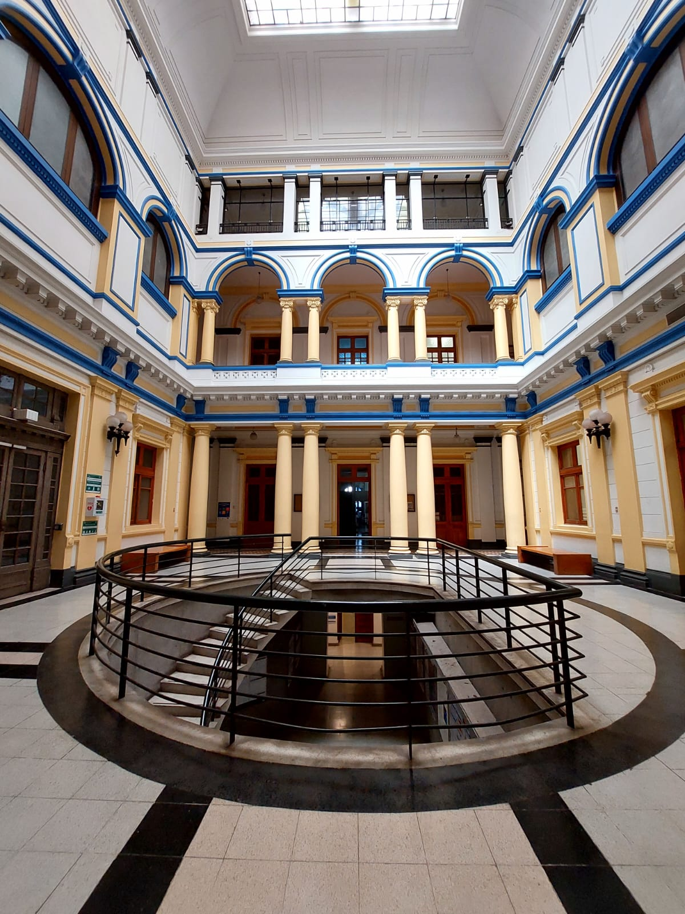
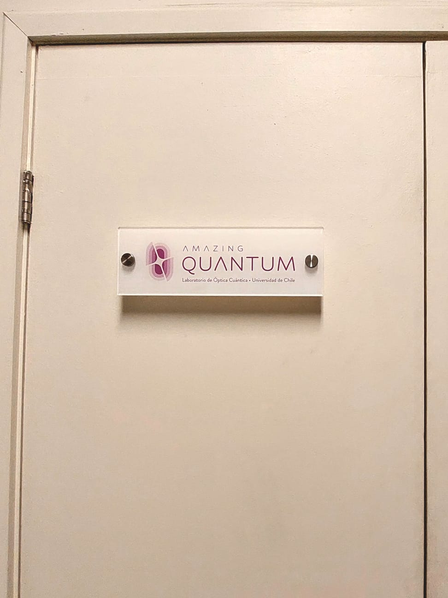
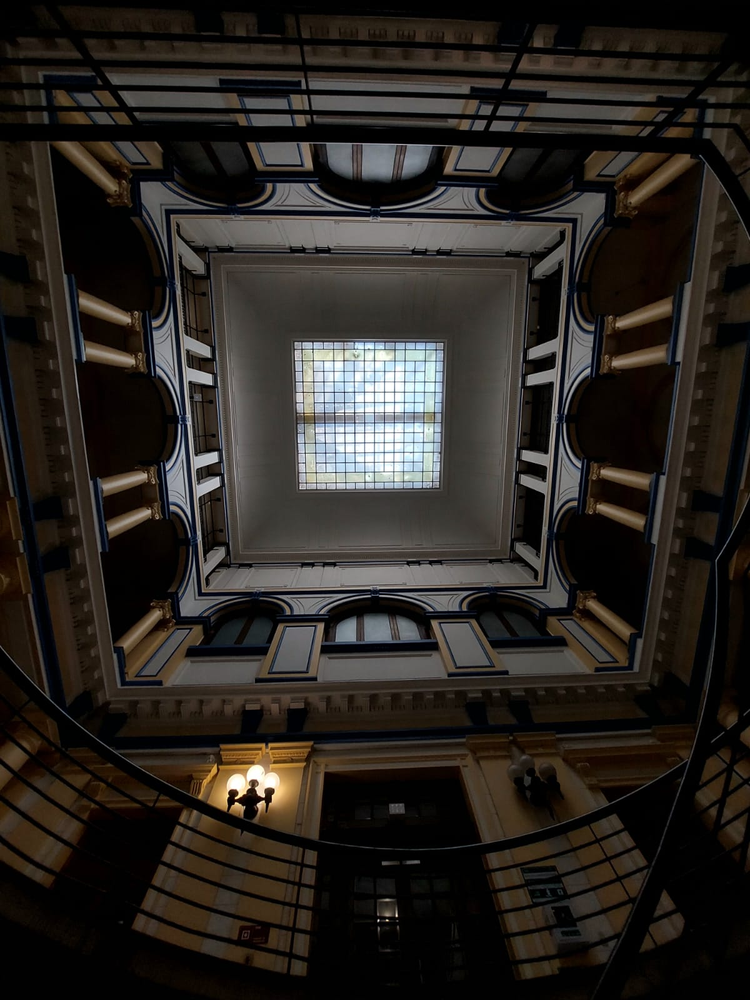
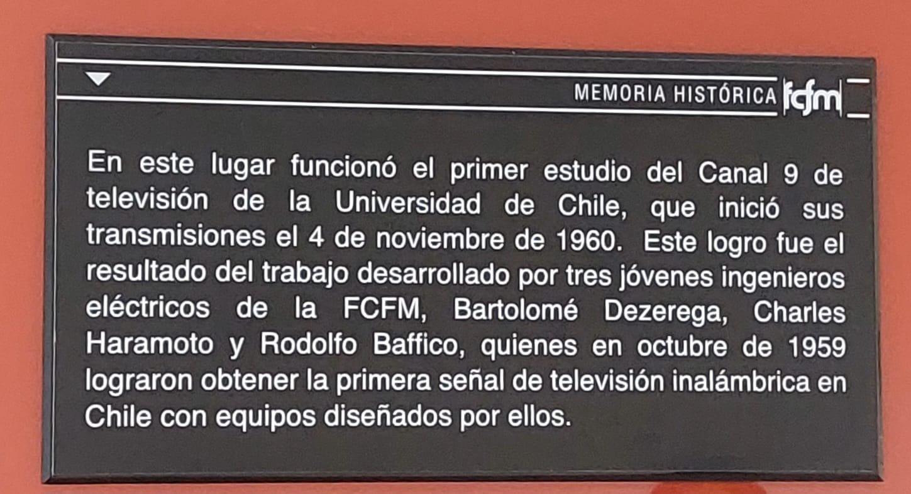

### Research Internship in Quantum Optics: Collaboration between Argentina and Chile 🇦🇷🇨🇱

During January 2026, I had the pleasure of conducting a research internship at [the Department of Physics](https://dfi.uchile.cl/) of the University of Chile, joining the [Amazing Quantum Group](https://www.amazingquantum.com/) led by [Dr. Carla Hermann-Avigliano](https://www.amazingquantum.com/copia-de-el-equipo).

My work focused on the theoretical characterization of intense non-Gaussian quantum light. We investigated generalized coherent states through quantum information measures and higher-order correlators to detect non-classicality features—a fundamental challenge in modern quantum optics.

The highlights of this experience were:

*Theory-Experiment Synergy*. Although my focus is theoretical, participating in the laboratories and handling cutting-edge equipment provided an invaluable perspective on the real challenges of experimental implementation.

*Academic Exchange*. Participating in Journal Clubs and presenting my progress to the group was key to receiving constructive feedback and refining my quantum dynamics models.

*Closing the Cycle*. I concluded the stay by presenting a [poster](../../aux/posters/poster_mendez_et_al_internship_dfi.pdf) with the results obtained during [the DFI Summer Internship 2026](https://dfi.uchile.cl/noticias/237309/cierre-practicas-de-verano-fisica-2026) closing session.

I take with me not only new technical knowledge but also the experience of having shared this time with an exceptional human group, known for their warmth and helpfulness. I am deeply grateful to the Amazing Quantum Group for opening their doors to me and for the enriching discussions that will undoubtedly impact the final stage of my PhD.

### Galería de la Estancia

::: {layout-ncol=3}

](figures/2026_summer_internship_chile_04.jpeg)

, postdoctoral researcher at the Amazing Quantum Group](figures/2026_summer_internship_chile_03.jpeg)

<!--  -->
<!--  -->
:::

<!-- quarto render january_2026_internship_chile.qmd --to html
quarto render january_2026_internship_chile.qmd --to pdf -->